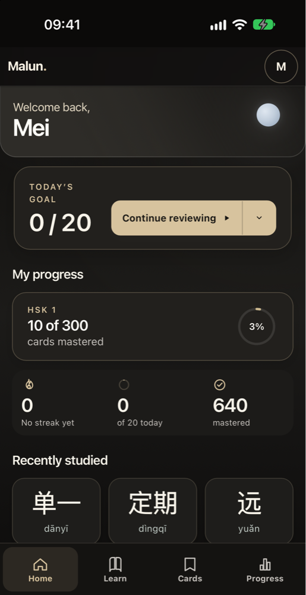
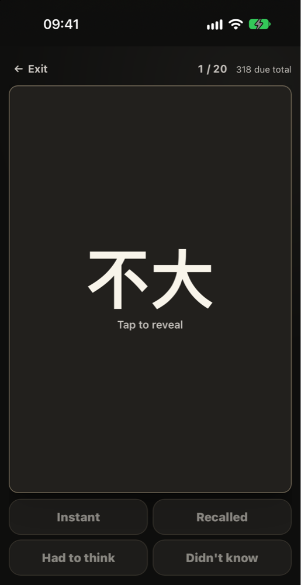
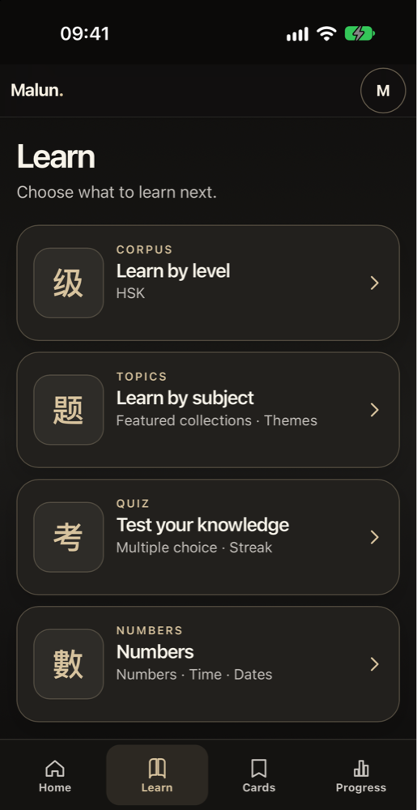
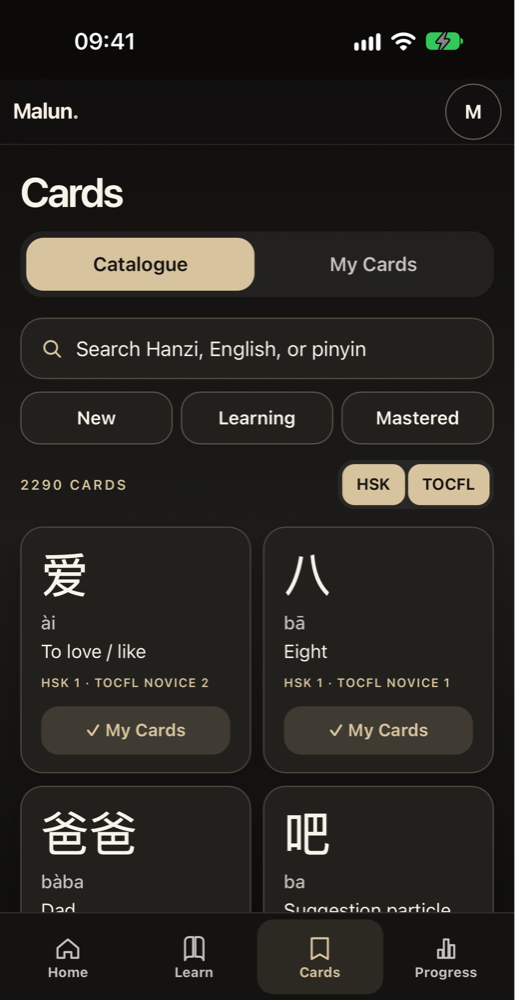
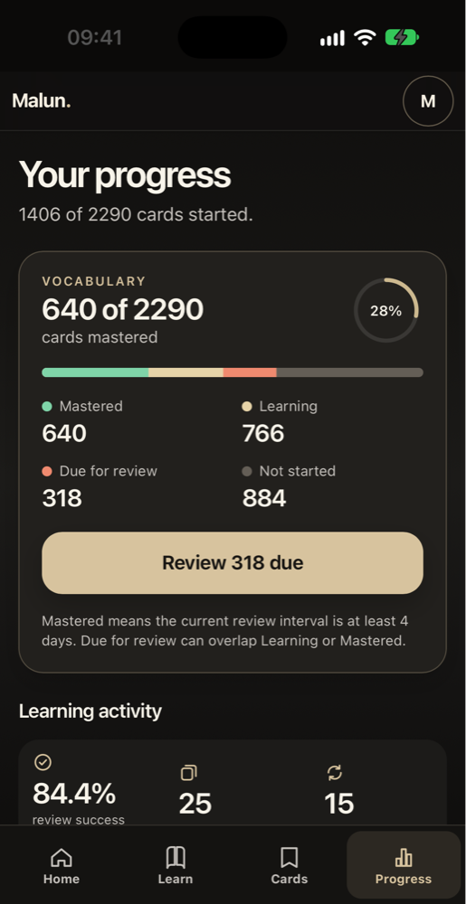

# Malun

**Learn Mandarin with clarity.** Malun is a hanzi-first flashcard app for
learners preparing the TOCFL (Taiwan) and the HSK (mainland China), in
traditional or simplified characters.

→ [mandarin.antoineleflon.com](https://mandarin.antoineleflon.com)

This repository is a showcase. The source code is private; this page explains
what the app does and how it is built and run.

  
  
  
  
  

Home · Review · Learn · Cards · Progress (iPhone, dark theme, demo account)

## What it does

- **Learn**: browse cards by TOCFL level, HSK level or topic (animals, the
  face, countries…), with pinyin, meaning and pronunciation.
- **Review**: spaced repetition. You see the character, tap to reveal it,
  and say how it went, from "Didn't know" to "Instant". A card counts as
  *mastered* once its interval reaches four days.
- **My Cards**: save cards while learning and organise them in your own lists.
- **Quiz**: HSK and TOCFL quizzes in two modes, Classic and Streak, plus a
  numbers drill.
- **Progress**: what is mastered, in progress, due or not started, by level
  and by topic.
- **Script choice**: traditional or simplified, with Taiwanese pinyin where
  usage differs from the mainland.

The corpus has more than 10,000 active cards and covers TOCFL level 3 (B1)
in full.

## How it is built

| Layer | Choice |
| --- | --- |
| Backend | Python 3.13, Django 5.2 LTS, Django REST Framework |
| Frontend | Django templates and HTMX, no SPA framework |
| Database | PostgreSQL |
| Identity | Keycloak (OpenID Connect), with Google as an identity provider |
| Mobile | iOS app built with Capacitor |
| Runtime | Gunicorn behind nginx, Docker Compose |
| Analytics | PostHog |

A few design decisions:

- **A modular monolith.** One Django project split into clear modules. It is
  simpler to run, test and reason about than services, for one developer.
- **Home-made spaced repetition.** Review states and review events are stored
  separately, so the schedule can always be rebuilt from history.
- **Quizzes do not touch the review schedule.** Testing yourself is not the
  same as studying, and mixing the two skews the intervals.
- **Pronunciation through the browser's speech synthesis**, with no audio
  files to host.

## How it is run

Malun is self-hosted in [ATL-Lab](https://github.com/Antoine-DOT/atl-lab),
my home lab, on a dedicated production VM behind a single reverse proxy.

Every change follows the same path: development, then a preview environment
deployed by [atl-preview-controller](https://github.com/Antoine-DOT/atl-preview-controller),
then production. A release is one full commit SHA, and the release script
refuses it unless:

- that exact commit has been deployed to preview and I have tested it there;
- a written approval for that commit exists;
- it descends from what is currently in production;
- the database backup taken just before the migrations has been checked.

Rolling back is scripted too, and refuses to run if it would need to undo a
database migration.

Most of the code is written with AI coding agents (Claude Code and Codex).
I own the product, the design and the reviews, and every release goes through
the same gates whoever wrote the code.

## Status

In production and in active development. Next: topics by theme, a new
onboarding, and a subscription model.

---

Built by [Antoine Leflon](https://antoineleflon.com).
